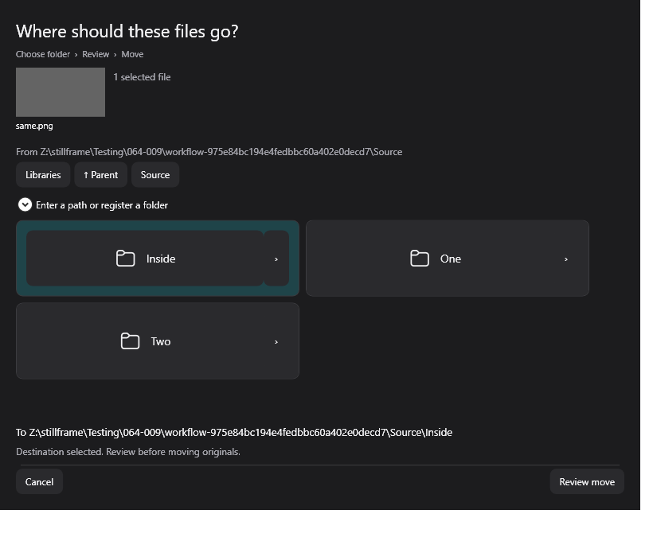
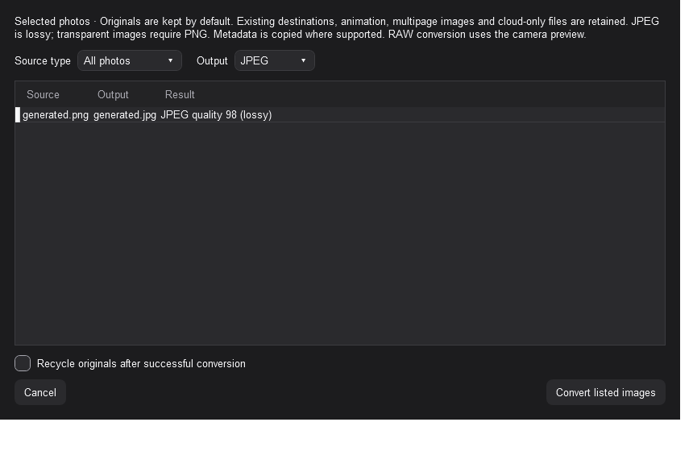
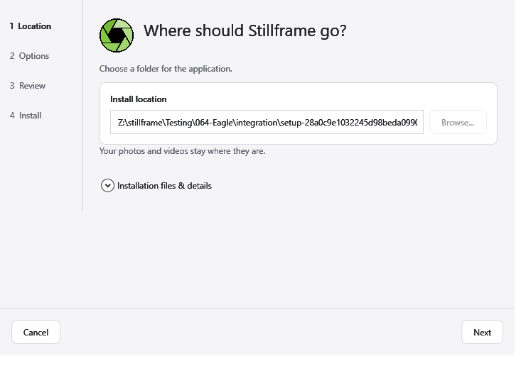

  <picture>
    <source media="(prefers-color-scheme: dark)" srcset="assets/stillframe-orchid.png">
    <source media="(prefers-color-scheme: light)" srcset="assets/stillframe-alpine.png">
    
  </picture>

<h1 align="center">Stillframe 0.6.4</h1>

Organize photos and videos where they already live.

  <a href="https://github.com/sys-manny/stillframe-release/releases/tag/v0.6.4">Download 0.6.4</a>
  &nbsp; · &nbsp;
  <a href="INSTALL-0.6.4.md">Installation guide</a>
  &nbsp; · &nbsp;
  <a href="https://github.com/sys-manny/stillframe-release/issues">Report a problem</a>

**Windows x64 · Beta · Free for personal, noncommercial use**

| Browse | Organize | Review |
| --- | --- | --- |
| Photo/video grid, folders, filmstrip and in-app playback | Per-library tags, graphical moves and batch rename | Exact or visual duplicates, thumbnail choices and image conversion |

## What's new in 0.6.4

- Guided installation with Location → Options → Review → Install, visible stage progress, and the desktop shortcut selected by default.
- Folder tiles for choosing where files go, followed by a move review and explicit handling of name conflicts.
- Consistent photo/video control spacing, permanent previous/next navigation, and separate ten-second video seeks.
- Play-through starts the selected video and continues through its folder; a multi-selection limits the temporary sequence to selected videos.
- Volume starts at 100%, supports up to 150%, and remembers your choice between files and sessions.
- Corrections to close handling, tag editing, file/folder operations, extension sorting, and dark-theme image export.

## Move files visually

Choose a destination tile, open a folder with its arrow, and review the move before changing files. Existing-name conflicts offer explicit choices; originals are not silently overwritten.

<picture>
  <source media="(prefers-color-scheme: dark)" srcset="assets/stillframe-064-move-dark.png">
  <source media="(prefers-color-scheme: light)" srcset="assets/stillframe-064-move-light.png">
  
</picture>

*Actual interface captured during 0.6.4 feature verification with generated files. Paths and names are disposable examples, not a personal collection.*

## Photos, videos and tags

Browse photos and videos together or filter by media type. Use the thumbnail grid or a list, navigate folders, and open media in the viewer. Photos support Fit, zoom and temporary view-only rotation. Videos support Play to end, Repeat current, and Play through the folder.

Describe your collection when importing a library to review locally suggested collection types and vocabulary, or skip the description. Tag folders, individual files, or selected groups. Each library keeps its own vocabulary; suggestions do not automatically tag your media.

Choose video thumbnails from timestamped alternatives, adjust a sampling range, and pin an option while re-rolling others. Applying **Use thumbnail** saves the selected choice. Missing thumbnails remain placeholders until you explicitly generate them; automatic browsing does not create missing thumbnails or promise background browsing acceleration.

## Review and convert

Check exact duplicates or visually similar files, then choose what to keep. Undecided groups are left alone; recycling requires confirmation.

The image-conversion review lists source/output names before you apply the change. **Convert listed images** sits at the lower right. Recycling originals is off by default.

<picture>
  <source media="(prefers-color-scheme: dark)" srcset="assets/stillframe-064-convert-dark.png">
  <source media="(prefers-color-scheme: light)" srcset="assets/stillframe-064-convert-light.png">
  
</picture>

*Actual 0.6.4 feature-verification capture using a generated image.*

## Install

1. [Download the 0.6.4 setup and application ZIP](https://github.com/sys-manny/stillframe-release/releases/tag/v0.6.4) into the **same folder**.
2. Run `Stillframe-0.6.4-Setup.exe`, choose a location and options, review, then install.
3. Open Stillframe and add your media folders through **Manage libraries**.

<picture>
  <source media="(prefers-color-scheme: dark)" srcset="assets/stillframe-064-setup-dark.png">
  <source media="(prefers-color-scheme: light)" srcset="assets/stillframe-064-setup-light.png">
  
</picture>

*Actual packaged installer in a no-install preview. The displayed location is a generated verification path.*

The .NET Desktop runtime is included. For portable use, extract the **complete** `Stillframe-0.6.4-win-x64.zip` and run its root `Stillframe.exe`; keep all extracted files together. Another extracted copy can share your Windows user's Stillframe settings and caches, so it is not automatically an isolated profile.

Optional local tag suggestions use **both** `Stillframe-0.6.4-visEngine-01.sfa` and `Stillframe-0.6.4-visEngine-02.sfa`. Optional `Stillframe-0.6.4-RTX.sfa` provides acceleration on supported NVIDIA GPUs. Keep selected addons beside setup. Neither addon is required for the base app. See the [installation guide](INSTALL-0.6.4.md) and release checksums.

## Your files and privacy

Media stays in its existing folders unless you explicitly move, rename, convert or recycle it. Local AI analysis does not upload your media. CLIP is bundled for visual duplicate matching; the optional visEngine provides local tag suggestions.

For on-demand folders, existing saved previews can be browsed without requesting originals. Access to originals remains subject to the library's download permission and desktop cloud provider. Provider behavior is not universally verified.

Export a `.sflib` package to carry a library's catalog, tags and vocabulary to another installation. It does **not** contain original media. Reconnecting a changed path requires validation; unresolved records may block reconnection.

## Beta limits

The app and installer are unsigned. Windows may show a SmartScreen reputation warning. Keep backups and review file changes before applying them.

- Automatic browsing uses saved information. Background browsing acceleration and further thumbnail/media-information improvements remain deferred.
- Idle CPU optimization and biometric/people features are deferred.
- Device, cloud-provider, codec, accessibility, high-DPI and fresh-PC coverage is incomplete. Focused checks and screenshots are not a guarantee for every system.
- **Before returning to 0.6.3, set volume to 100% or lower in 0.6.4.** The older version rejects higher saved values.

Read [known limitations](KNOWN-LIMITATIONS-0.6.4.md) and [release notes](RELEASE-0.6.4.md). To report a problem, include the version, reproduction steps, expected/actual behavior and exact error. Leave private media and personal information out of public reports.

## Why Stillframe exists

I kept running into the same tradeoffs with media managers. Some had the tools but a frustrating layout. Others looked great but were missing features I used. A few came close, but weren't free.

F-Spot Photo Manager on Ubuntu 8.04 LTS, running GNOME, was an early reference point for me. I remember wondering why something that smooth and easy to use couldn't make its way to Windows. If parts of Stillframe feel familiar to you, now you know why.

Eventually, I figured, why the heck not? In the spirit of Thanos reaching for the stones: I'll do it myself.

Stillframe is the result. The goal is to put a usable layout and useful tools in the same application, free for personal use.

## License

Stillframe is free for personal, noncommercial use under the [Stillframe Personal Use License](LICENSE). Commercial and organizational use require separate permission. Third-party components retain their own licenses.

This repository contains public downloads, documentation and issue reports. **Application source and development history remain private.**
