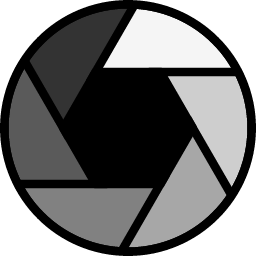
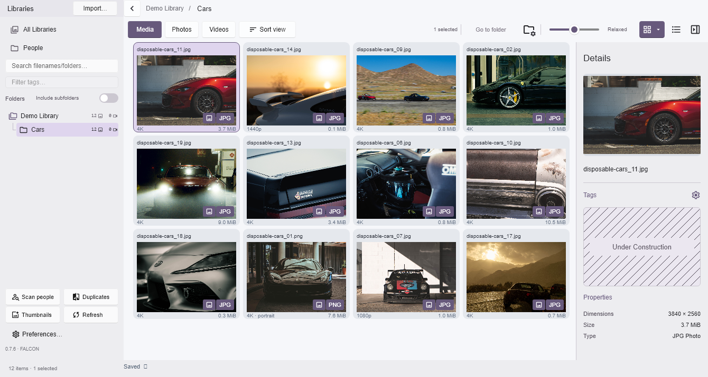
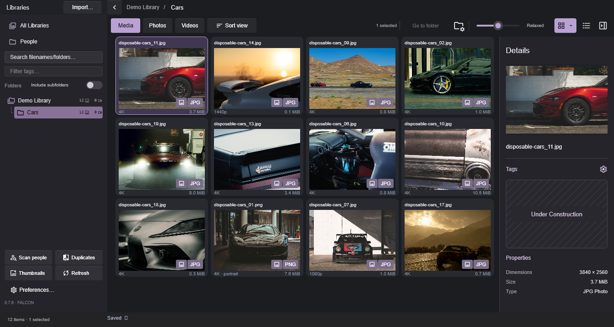

<h1 align="center">Stillframe 0.7.6</h1>

Browse, organize, and review photos and videos in their existing folders.

  <a href="https://github.com/sys-manny/stillframe-release/releases/download/v0.7.6/Stillframe-0.7.6-win-x64.zip"><strong>Download for Windows x64</strong></a>
  &nbsp; · &nbsp; <a href="INSTALL-0.7.6.md">Getting started</a>
  &nbsp; · &nbsp; <a href="https://github.com/sys-manny/stillframe-release/issues">Report a problem</a>

## Light and dark modes

| Light | Dark |
| --- | --- |
|  |  |

In **Preferences → Theme**, choose **Light**, **Dark**, or **System** to follow Windows. Both views show the same photos from the disposable demo library.

### Accent colors

Under **Preferences → Accent**, choose **Sage**, **Arctic**, **Rose**, or **Orchid**. Each accent works in both themes.

## What's new since 0.7.2

- **People.** Stillframe uses YuNet to detect faces and OpenFace with SFace to suggest groups. Click a stack's count badge to open or close it in place. Compare suggested matches using source photos with face outlines, and ignore unwanted detections such as reflections.
- **Thumbnails.** One **Generate thumbnails** button fills in missing thumbnails for the selected files, folder, or library. Generation runs in the background, and you can still choose a frame for a video thumbnail.
- **Browsing.** Staggered Grid uses saved dimensions to size cards early. It keeps recently viewed thumbnails in memory and preloads the next screen.
- **Portable startup.** Open `Stillframe.exe` directly. The splash shows startup progress while the app opens.
- **Format support.** The viewer and thumbnail generator handle more JPEG, PNG, and WebP files, including the reported JPEGs with extra data after the first complete image.

## Photo viewer

Use the filmstrip to move through a folder. Fit, zoom, pan, and rotate photos in the viewer.

*Photo viewer rendered with the same demo library.*

## Run the portable app

1. [Download the ZIP](https://github.com/sys-manny/stillframe-release/releases/download/v0.7.6/Stillframe-0.7.6-win-x64.zip) and extract the entire archive to a writable folder.
2. Open `Stillframe.exe`.
3. Choose **Import** to add a media folder.

For a 0.7.5 upgrade, close Stillframe, then copy your complete `app/Stillframe` profile to the new release's `app` folder. That profile contains settings and saved thumbnails. Use the same paths for the original media.

[Getting started](INSTALL-0.7.6.md) · [Release notes and known limits](RELEASE-0.7.6.md) · [SHA-256 checksums](https://github.com/sys-manny/stillframe-release/releases/download/v0.7.6/SHA256SUMS.txt)

## License and runtime source

Stillframe is free for personal, noncommercial use under the [Stillframe Personal Use License](LICENSE). Media and face processing run locally.

0.7.6 ships with the same playback DLLs as the 0.7.2 public release. [Corresponding playback runtime source](https://github.com/sys-manny/stillframe-release/releases/download/v0.7.2/Stillframe-0.7.2-playback-runtime-source.zip)
