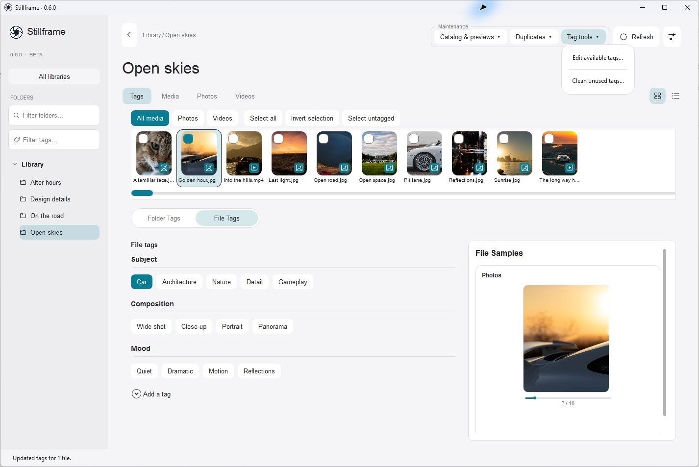
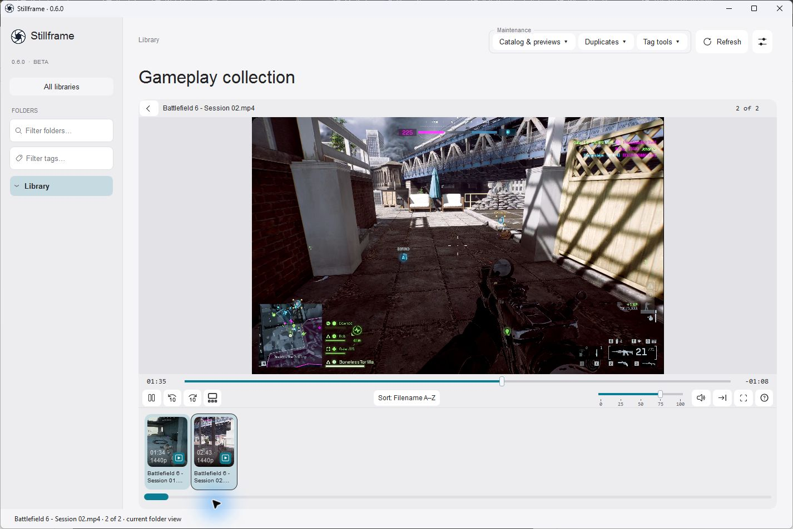
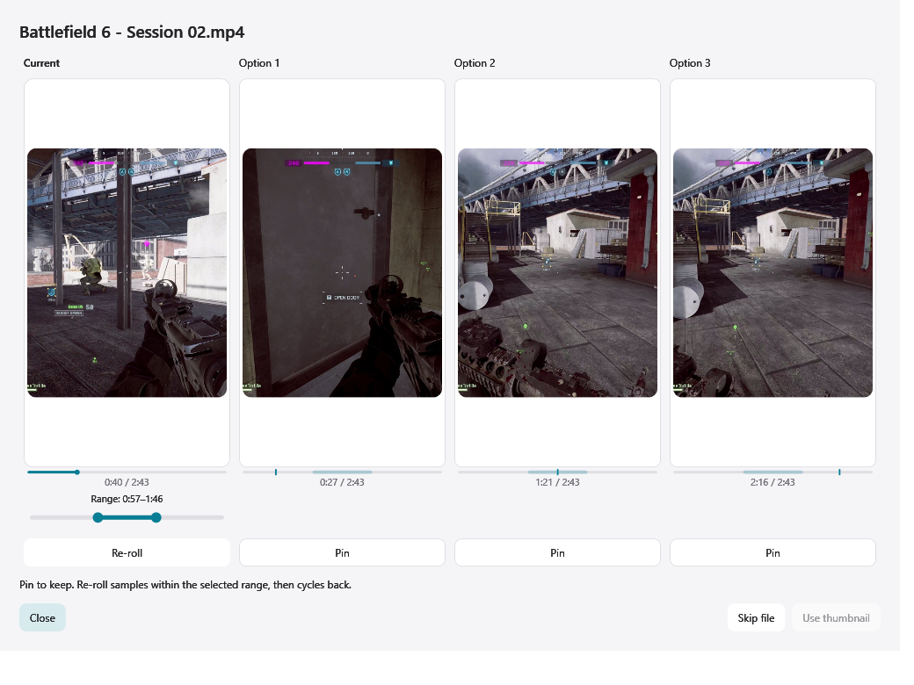
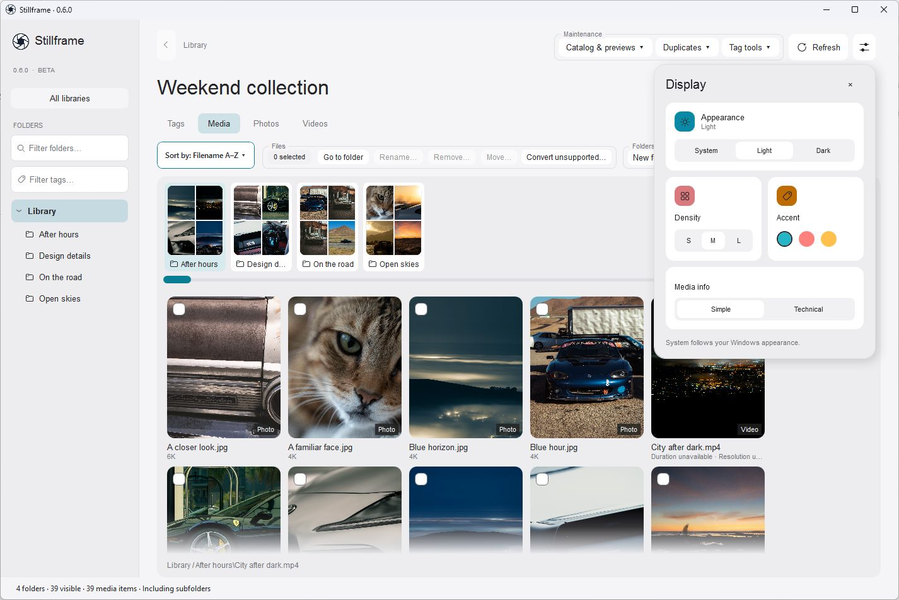

  <picture>
    <source media="(prefers-color-scheme: dark)" srcset="assets/stillframe-logo-light.png">
    <source media="(prefers-color-scheme: light)" srcset="assets/stillframe-logo-dark.png">
    
  </picture>

<h1 align="center">Stillframe</h1>

A Windows app for organizing photos and videos.

  <a href="https://github.com/sys-manny/stillframe-release/releases">Download 0.6.0 Beta</a>
  &nbsp; | &nbsp;
  <a href="https://github.com/sys-manny/stillframe-release/issues">Report a problem</a>

*Screenshots use demo media. Some video labels in the photography examples are illustrative; the gameplay examples use actual video recordings.*

## Browsing

You can view photos and videos together or filter by type. Folder covers and thumbnail strips let you browse without opening each file. Scroll to look around; click to select; double-click to open.

Rename batches in the order they're currently sorted. Review rename, move and removal actions before applying them.

## Tags

Tag a folder, an individual file, or several selected items at once. Each library has its own vocabulary, so a photography collection doesn't have to use the same tags as a folder of gameplay recordings.

Tags are grouped by category. **Tag tools** lets you edit the available choices and clean unused tags. Use the sidebar tag filter to find tagged items later.

## Video playback and thumbnails

Watch clips in the app and use the filmstrip to move between them. During playback, the back and forward controls seek ten seconds. **Play to end**, **Repeat** and **Play through** control what happens next; Stillframe remembers your choice.

Automatic video thumbnail choices sample the first, middle and last thirds. If you'd rather choose, compare the timestamped options or set a smaller range. Drag either handle to resize the range, or drag between them to move it. Pin an option to keep it while you re-roll the others.

Choosing a range doesn't replace the current thumbnail. **Use thumbnail** applies your choice; failed or cancelled generation keeps the previous image.

## Duplicate review

Stillframe can check for exact duplicates and visually similar files. Review each group and choose what to keep. You can keep more than one copy, keep the entire group, or leave it undecided.

Recycling requires confirmation. An undecided group is left alone.

## Moving a library to another installation

Export a **`.sflib` package** from Manage libraries, then import it into another Stillframe installation. It carries the catalog, folder and file tags, and the library's vocabulary.

Library exports include cached previews and metadata. The preference-export option brings app settings instead and excludes rebuildable caches.

**The package doesn't contain your original media.** Keep those files accessible on the destination PC. If the folder path changes, use **Locate** to reconnect it.

## Local AI and cloud folders

CLIP is included for visual duplicate matching. The optional **visEngine** addon, powered by Qwen, suggests tags for you to review. It runs on CPU; the optional **RTX Acceleration** addon can speed it up on supported NVIDIA GPUs.

AI analysis runs locally. Stillframe doesn't upload your media for it.

For on-demand cloud folders, your desktop provider handles downloading originals. **Allow cloud downloads** controls whether Stillframe can access those files for thumbnail generation. Existing cached previews can still be used with that permission off.

## Display

Choose Light, Dark or System. The **Display** panel also controls thumbnail density, accent color, and simple versus technical media information.

## Install

Requires **64-bit Windows**. The .NET Desktop runtime is included.

1. Download `Stillframe-0.6.0-Setup.exe` and `Stillframe-0.6.0-win-x64.zip` into the same folder.
2. Run setup and choose an installation folder.
3. Open Stillframe and add a media folder through Manage libraries.

Setup creates a Start menu shortcut and offers a desktop shortcut. Optional visEngine and RTX downloads are on the same release page. Setup verifies them and joins the visEngine parts automatically.

For a portable installation, extract the complete application ZIP and run `Stillframe.exe`. Keep the extracted files together.

[Download Stillframe](https://github.com/sys-manny/stillframe-release/releases)

## Why Stillframe exists

I kept running into the same tradeoffs with media managers. Some had the tools
but a frustrating layout. Others looked great but were missing features I used.
A few came close, but weren't free.

F-Spot Photo Manager on Ubuntu 8.04 LTS, running GNOME, was an early reference
point for me. I remember wondering why something that smooth and easy to use
couldn't make its way to Windows. If parts of Stillframe feel familiar to you,
now you know why.

Eventually, I figured, why the heck not? In the spirit of Thanos reaching for the
stones: I'll do it myself.

Stillframe is the result. The goal is to put a usable layout and useful tools in
the same application, free for personal use.

## License

Stillframe is free for personal, noncommercial use under the [Stillframe Personal Use License](LICENSE). Commercial and organizational use require separate permission. Application source remains private; third-party components retain their own licenses.

## Before you use the beta

Keep backups of important media and check file-operation previews before applying changes. The app and installer are unsigned, so Windows may show a SmartScreen reputation warning.

To report a bug, [open an issue](https://github.com/sys-manny/stillframe-release/issues) with steps to reproduce, expected and actual behavior, and your Stillframe version. Include a screenshot or recording if useful. Leave private media and personal information out of public reports.

This repository contains public downloads, documentation and issue reports. The application source remains private.
