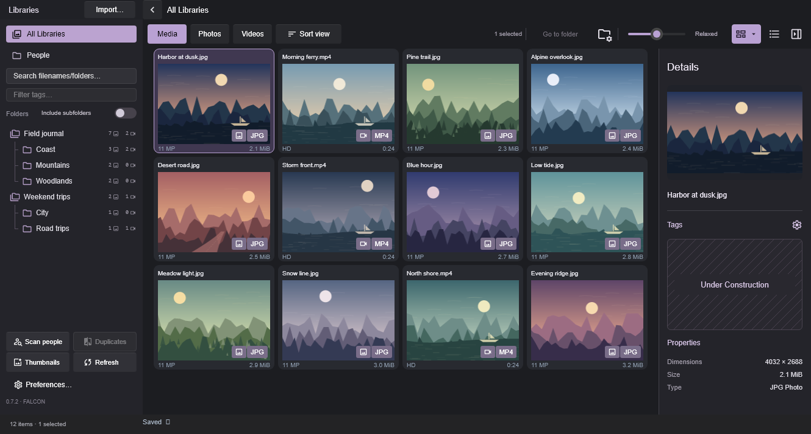
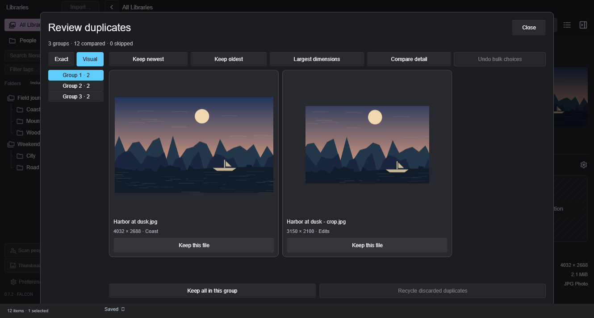

<h1 align="center">Stillframe 0.7.2</h1>

Browse, organize, and review photos and videos in their existing folders.

  <a href="https://github.com/sys-manny/stillframe-release/releases/download/v0.7.2/Stillframe-0.7.2-win-x64.zip"><strong>Download for Windows x64</strong></a>
  &nbsp; · &nbsp; <a href="INSTALL-0.7.2.md">Getting started</a>
  &nbsp; · &nbsp; <a href="https://github.com/sys-manny/stillframe-release/issues">Report a problem</a>

<picture>
  <source media="(prefers-color-scheme: dark)" srcset="assets/stillframe-072-library-dark.png">
  <source media="(prefers-color-scheme: light)" srcset="assets/stillframe-072-library-light.png">
  
</picture>

*Stillframe 0.7.2 interface rendered with illustrated sample media.*

| Browse | Organize | Review |
| --- | --- | --- |
| All Libraries, continuous Grid and Column views, search, and sorting | Rename and move files, manage folders, and pin video thumbnails | Exact and Visual duplicate review, plus local People scans and named albums |

## What's new in 0.7.2

- **All Libraries** brings imported folders into one view. Browse a single folder or turn on **Include subfolders** to see media further down the tree.
- **People** detects faces locally with YuNet and suggests matches with OpenFace. Scan selected folders, confirm names, and browse a person's photos as an album.
- **Thumbnails** offers Selected, This folder, and Library scopes. Generation runs in the background with progress and Cancel in the footer.
- **Duplicate review** compares exact copies or visually similar photos within a library. Stop a scan to review the matches already found and resume it when ready.
- The viewer and thumbnail generator handle JPEGs with an unset EXIF orientation.

## Compare duplicates

Review similar photos side by side. Choose a keeper, or keep every file in a group. You can compare detail or use relative size to see how a crop relates to its original.

## Run the portable app

1. Download the Windows ZIP and extract the **entire archive** to a writable folder.
2. Open `Launch.cmd`.
3. Choose **Import** to add your existing media folders.

Settings, thumbnail cache, and People data are stored beside the app. A new extraction starts with a fresh profile. This release is unsigned, so Windows may show a SmartScreen reputation warning.

[Getting started](INSTALL-0.7.2.md) · [Release notes and limits](RELEASE-0.7.2.md) · [Previous 0.6.4 release](https://github.com/sys-manny/stillframe-release/releases/tag/v0.6.4)

## License and runtime source

Stillframe is free for personal, noncommercial use under the [Stillframe Personal Use License](LICENSE). Media and face processing run locally. The public repository contains downloads and documentation.

The bundled playback runtime uses libmpv and FFmpeg. Its corresponding third-party source, build configuration, and notices are available from the same release page. [Playback runtime source](https://github.com/sys-manny/stillframe-release/releases/download/v0.7.2/Stillframe-0.7.2-playback-runtime-source.zip) · [SHA-256 checksums](https://github.com/sys-manny/stillframe-release/releases/download/v0.7.2/SHA256SUMS.txt)
