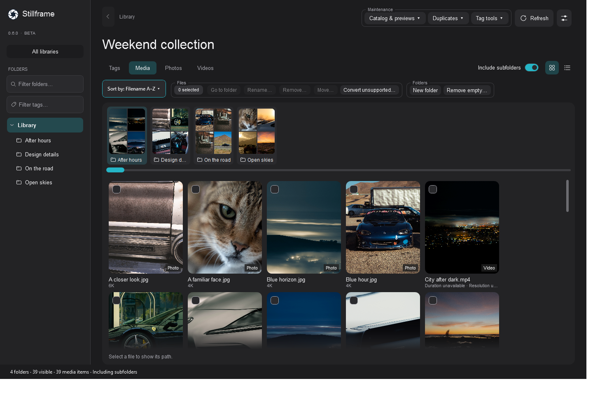
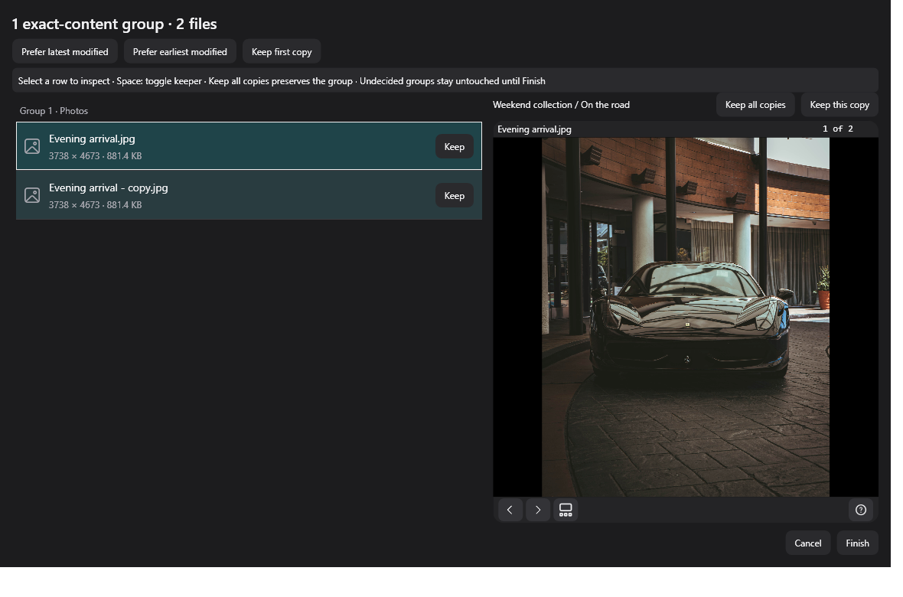
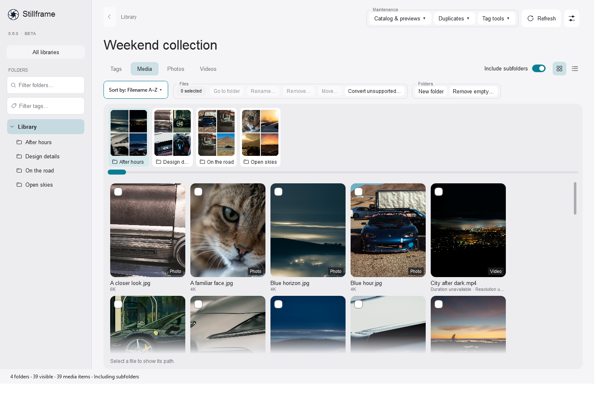

  <picture>
    <source media="(prefers-color-scheme: dark)" srcset="assets/stillframe-logo-light.png">
    <source media="(prefers-color-scheme: light)" srcset="assets/stillframe-logo-dark.png">
    
  </picture>

<h1 align="center">Stillframe</h1>

<strong>Your media. A clearer view.</strong>

A home for your photo and video collections—right where they already live.

<strong>Windows desktop · Public beta 0.6.0 · Optional local AI</strong>

  <a href="https://github.com/sys-manny/stillframe-release/releases"><strong>Download Stillframe</strong></a>
  &nbsp; · &nbsp;
  <a href="https://github.com/sys-manny/stillframe-release/issues">Report an issue</a>

Actual Stillframe interface with demo media. Video thumbnail labels are illustrative.

## Less searching. More seeing.

Bring folders together in one visual workspace. Browse photos and videos, move through thumbnail carousels, and find your way back with meaningful tags.

**Your originals stay in place.** Stillframe catalogs the folders you choose, without moving your collection into an application folder.

| See it your way | Make it easier to find |
| --- | --- |
| Browse photos and videos together or separately. | Tag folders and individual files. |
| Choose thumbnails and centered crops. | Give each library its own tag vocabulary. |
| Set a video range, compare options, pin and re-roll. | Rename batches in their displayed sort order. |
| Switch between light, dark and system appearance. | Review file changes before applying them. |

## Keep the memories. Review the copies.

Find exact duplicates or visually similar media, inspect the candidates, and choose what stays. Keep one, keep several, or keep everything. Undecided groups stay untouched, and recycling requires confirmation.

## Optional intelligence. Local processing.

**CLIP is included** for visual duplicate matching.

Add **visEngine**, powered by Qwen, for local visual tag suggestions you review before applying. It works on CPU, with optional **RTX Acceleration** on supported NVIDIA GPUs.

**Media is not uploaded for AI analysis.** Cloud-backed folders work through their desktop provider; opening an on-demand original may download it. Thumbnail download permission is controlled per library.

## Light when you want it.

The same workspace, with a lighter touch. Choose Light, Dark or System to suit your setup.

## Start with a folder.

1. Download **`Stillframe-0.6.0-Setup.exe`** and **`Stillframe-0.6.0-win-x64.zip`** into the same folder.
2. Run setup and choose where to install.
3. Open Stillframe and add an existing media folder.

Setup creates a Start menu shortcut and offers an optional desktop shortcut. Optional addon downloads are listed on the release page; setup verifies and joins the visEngine files automatically.

Prefer portable? Extract the complete application ZIP and run **`Stillframe.exe`**. Keep its contents together.

**Requires 64-bit Windows.** The .NET Desktop runtime is included; no separate .NET installation is needed.

[**Download the public beta →**](https://github.com/sys-manny/stillframe-release/releases)

---

### A note about the beta

Stillframe is actively being refined. Keep backups of important media and review file-operation plans before applying them. The app and installer are currently **unsigned**, so Windows may display a SmartScreen reputation warning.

Found something unexpected? [Report an issue](https://github.com/sys-manny/stillframe-release/issues) with the version, steps to reproduce, and a screenshot or recording when useful. Leave private media and personal information out of public reports.

This repository hosts public downloads, documentation and issue reports. Application source code is not distributed here.
