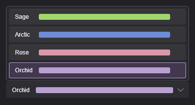
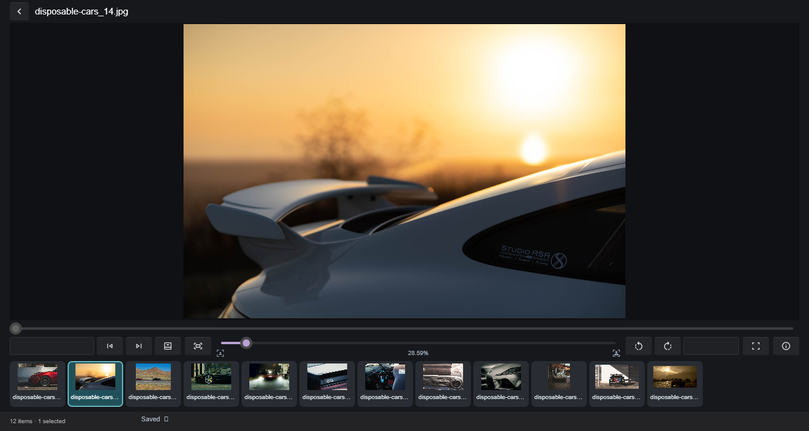

<h1 align="center">Stillframe 0.8.0</h1>

Browse, organize, and review photos and videos in their existing folders.

  <a href="https://github.com/sys-manny/stillframe-release/releases/download/v0.8.0/Stillframe-0.8.0-win-x64.zip"><strong>Download for Windows x64</strong></a>
  &nbsp; · &nbsp; <a href="INSTALL-0.8.0.md">Getting started</a>
  &nbsp; · &nbsp; <a href="https://github.com/sys-manny/stillframe-release/issues">Report a problem</a>

## Light and dark modes

| Light | Dark |
| --- | --- |
|  |  |

In **Preferences → Theme**, choose **Light**, **Dark**, or **System** to follow Windows. Both views show the same photos from the disposable demo library. These theme examples were captured in 0.7.6; 0.8.0 adds the Hidden S logo, Source Sans 3 and updated player controls.

### Accent colors

Under **Preferences → Accent**, choose **Sage**, **Arctic**, **Rose**, or **Orchid**. Each accent works in both themes.

## Latest 0.8.0 update

- **Pop out photos and videos.** Use a borderless, always-on-top floating player with live aspect-preserving resize. Browse and open new media into it, move through the folder, then return to the main viewer.
- **Keep controls consistent.** Full-width translucent hover controls use Material Symbols, with volume/zoom sharing the right edge. Click the video viewport to play or pause.
- **Back up your profile.** In **Preferences → Backup & import**, toggle **Settings**, **Thumbnails**, **Tags** and **People data**. All four selects a complete profile. ZIP-format `.library` archives exclude original photos/videos; import preserves categories left off and retains the previous profile.
- **Restore reliably on exFAT.** Includes the accepted directory-rename recovery repair, with source checks, checksum validation and unknown-data protection retained.
- **Browse with a refreshed interface.** Source Sans 3, Hidden S branding, Slim inset scrollbars and plain slider dots. Video opening, playback during thumbnail generation and Empty thumbnail cache preparation are improved.

## What's new since 0.7.2

- **People.** Stillframe uses YuNet to detect faces and OpenFace with SFace to suggest groups. Click a stack's count badge to open or close it in place. Compare suggested matches using source photos with face outlines, and ignore unwanted detections such as reflections.
- **Thumbnails.** One **Generate thumbnails** button fills in missing thumbnails for the selected files, folder, or library. Generation runs in the background, and you can still choose a frame for a video thumbnail.
- **Browsing.** Staggered Grid uses saved dimensions to size cards early. It keeps recently viewed thumbnails in memory and preloads the next screen.
- **Portable startup.** Open `Stillframe.exe` directly. The splash shows startup progress while the app opens.
- **Format support.** The viewer and thumbnail generator handle more JPEG, PNG, and WebP files, including the reported JPEGs with extra data after the first complete image.

## Photo viewer

Use Previous/Next to move through a folder. Fit, zoom, pan and rotate photos in the main viewer or floating player.

*Earlier photo-viewer screenshot from the disposable demo library; 0.8.0 uses the updated hover controls described above.*

## Run the portable app

1. [Download the ZIP](https://github.com/sys-manny/stillframe-release/releases/download/v0.8.0/Stillframe-0.8.0-win-x64.zip) and extract the entire archive to a writable folder.
2. Open `Stillframe.exe`.
3. Choose **Import** to add a media folder.

To upgrade, use **Preferences → Backup & import** in your existing copy. Select **Settings**, **Thumbnails**, **Tags** and **People data** for a complete profile, save a `.library` archive, then import it in the new copy and restart. Original media stays in its folders. Closed-profile copying is also supported: preserve the complete `app/Stillframe` folder with all files/subfolders together.

[Getting started](INSTALL-0.8.0.md) · [Release notes and known limits](RELEASE-0.8.0.md) · [SHA-256 checksums](https://github.com/sys-manny/stillframe-release/releases/download/v0.8.0/SHA256SUMS.txt)

The portable app supports writable local NTFS and exFAT drives that Windows reports as fixed.

## Previous releases

Earlier downloads and their documentation are available on the [Releases page](https://github.com/sys-manny/stillframe-release/releases).

## License and runtime source

Stillframe is free for personal, noncommercial use under the [Stillframe Personal Use License](LICENSE). Media and face processing run locally.

0.8.0 ships with the same playback DLLs as the 0.7.2 public release. [Corresponding playback runtime source](https://github.com/sys-manny/stillframe-release/releases/download/v0.7.2/Stillframe-0.7.2-playback-runtime-source.zip)
